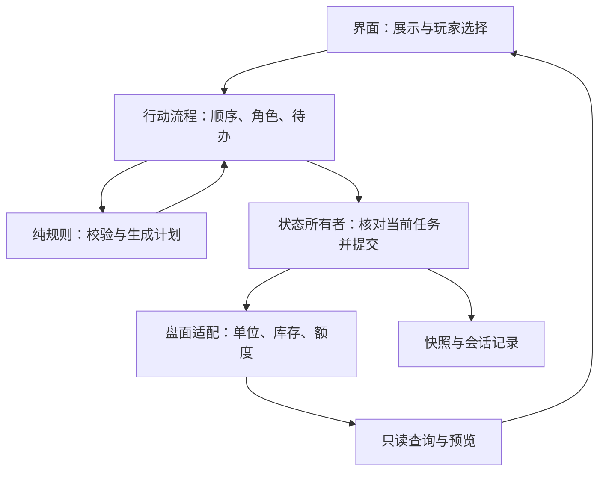

# 解耦与优化方案

更新：2026-11-04。执行顺序统一由[重构计划](重构计划.md)管理，本文件解释模块边界和优化依据。

本次按用户要求只调整计划：优先完成双方完整回合及非空运单位行动，空运后续列低优先级待办。以下空运实现保留为已有解耦案例，不作为下一批开发目标。

## 判断

需要继续渐进解耦。当前工作台仍约两万行、四百多个函数，既收界面输入，也构造规则事实、推进任务、改单位位置、扣补给、写额度与日志。已有独立域改善了部分流程，但多个模块仍能直接写同一份状态。

这使“一个动作改了多个地方”成为主要风险。例如空运此前先移动单位，再对SP单独检查卸载；单位不计入额度，后一步失败也不能撤回前一步。本轮用完整卸载计划与单一提交入口解决这条路径，作为后续其他流程的迁移样板。

优先改善规则正确性、状态所有权和提交完整性。性能优化需要单独测量；当前没有证据支持以更换框架或大规模重写作为性能方案。

## 目标边界

| 边界       | 负责                                   | 接口约束                                                        |
| ---------- | -------------------------------------- | --------------------------------------------------------------- |
| 界面       | 选择单位/货物、目标、返航点，呈现原因  | 只收输入，规则及额度由引擎给出                                  |
| 纯规则     | 合法性、费用、容量、战果和变更计划     | 输入事实、输出结果；不引Vue/Pinia、不改全局状态、不自行取随机数 |
| 行动流程   | 宣布、应答、掷骰、结算、返航顺序       | 通过只读事实与明确命令访问其他域；失败留在可继续的步骤          |
| 状态所有者 | 自己的任务状态、合法转换与重复提交保护 | 跨域不直接取得可写Ref；提交核对计划仍属于当前任务               |
| 盘面适配   | 应用位置、库存、死亡堆、额度变化       | 一次行动一个清晰提交入口，不重新计算规则                        |
| 查询/快照  | 只读视图、保存恢复                     | 与提交分开；中途任务须完整持久化或拒绝保存                      |

工作台逐步保留兼容入口、事实适配和域装配。现有公开操作名可保留，实际行为迁到相应域，减少界面和测试的一次性改动。

## 已有解耦案例

- `engine/rules/air-cargo-unload.ts`生成完整货物的卸载计划，区分送达、留存、额度消耗及超限后的运输机留场义务。
- `stores/air-cargo-resolution.ts`管理F步检查、骰序、卸载决策和收据；通过getter读任务与随机状态，不直接取得并改写空军任务Ref。
- `stores/air-mission.ts#commitCargo`由任务所有者确认仍是当前F步且尚未提交，再应用盘面计划并更新任务。失效计划不能覆盖下一趟任务。
- `stores/workbench.ts#applyAirCargoDelivery`统一应用单位落地/保留/死亡、SP送达和卸载额度。移动预算折算移到纯引擎，适配器不再自行重算。
- 界面负责选择完整货物；含单位且超限时由玩家决定，不静默拆单位或擅自决定卸哪支部队。
- 超限卸载的留场要求写入收据，返航读取已提交义务；改界面勾选不能解除它。
- `air-unit-transit`独立持有在途地面单位；地图查询只读取地图集合，避免在移动、补给、战斗各处重复排除。
- `air-unit-movement`生成阶段运输义务和真实地面MP准入计划；移动、突袭、战斗与炮兵轰炸消费同一义务。运输限制独立于模式和MP历史保存，不再靠虚扣MP代表半MA，重复任务不重复扣额度。

这些改动形成了部分明确的提交边界，尚未引入支持任意异常回滚的通用事务系统。对更多跨域行动迁移时，先覆盖失败场景，再决定是否需要共享提交器。

## 接下来的解耦顺序

1. **回合入口与阶段协调**：先核对完整双方回合、反应方身份、强制待办与实际界面入口；把首个流程阻断及后续行动列清，不以函数已拆出代替可玩验收。
2. **地面移动、补给与ZOC**：按真实动作构造事实并明确谁提交MP、燃料和SP；通用地面后勤、防接力、抽取/投递和抵消承诺直接推进，不等待空运。
3. **战斗与炮击提交**：补给、骰序、损失、选项、撤退和推进各有待办与提交点；与移动中的突袭衔接，防止重复结算和未收束即换段。
4. **其余单位行动与常用空军**：随增援、重建、工程、设施、本作专规、整备及常规空军任务的实际缺口迁移状态所有权，保持单位行动清单完整。
5. **结算点快照与整回合复查**：每个已走通的行动都检查保存恢复和下一合法操作；任意中途保存后置。只有完整持久化所有待决状态及骰序时，才开放相应中途保存点。
6. **空运后续与未启用选项**：联合承运、分货和部分返航等列待办，待常规完整回合及非空运行动覆盖后再做；最终全行动验收仍需补齐适用项。已适用的非空运罕见分支仍在第4项验收，不按使用频率移出主线。

结构整理服务于以上动作，不单独安排以拆文件或减行数为目标的大改造。每个迁移同时保留行为回归、双方回合衔接与界面验收，具体批次及退出条件以主计划为准。

真正解耦的判断标准是：谁拥有状态、谁有权提交、一项规则修改涉及哪些模块，以及能否不启动整个工作台就验证规则。文件变短只是结果之一。

## 性能：测量后确定优化对象

| 观察点         | 先记录什么                               | 有瓶颈证据后的措施                                   |
| -------------- | ---------------------------------------- | ---------------------------------------------------- |
| 点选与移动预览 | 选择到路径可见的耗时、相同状态下搜索次数 | 按位置/模式/阶段版本缓存查询；静态地形与动态占据分开 |
| 补给追溯       | 全图重判次数、逐单位读取次数             | 按依赖版本失效，建立按格索引；比较缓存与原算法结果   |
| 热坐与阶段切换 | 哪些computed和投影重算                   | 区分界面草稿和真实盘面变化，减少无关重算             |
| Canvas         | 每帧耗时、空闲时的重绘次数               | 分图层失效与重绘，验证命中检测和缩放一致             |
| 首次加载       | 包体、加载/校验/首帧耗时                 | 决定按视图拆包、延后非首屏内容，保留数据校验         |

生产构建仍约2.5MB未压缩JS，并有大包提示，适合独立测首屏成本。本轮没有完整性能基准，不声称已经提升帧率或搜索速度。保留读取次数、查询一致性等性能检查；耗时比较注明运行条件，不用放宽阈值替代优化。

## 每批验收

先覆盖成功、失败、需要选择和重试，再从真实store入口比较位置、库存、额度、死亡堆、随机游标与下一待办。跨域变更跑全量回归、类型/代码/格式/架构检查及构建；保存格式变化另加迁移与恢复后的下一行动验证。最终按剧本做真实界面验收，单测数量不能替代它。
